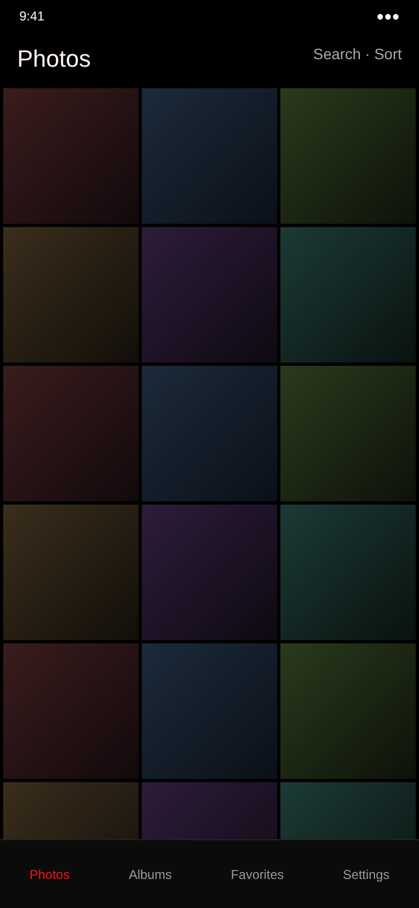
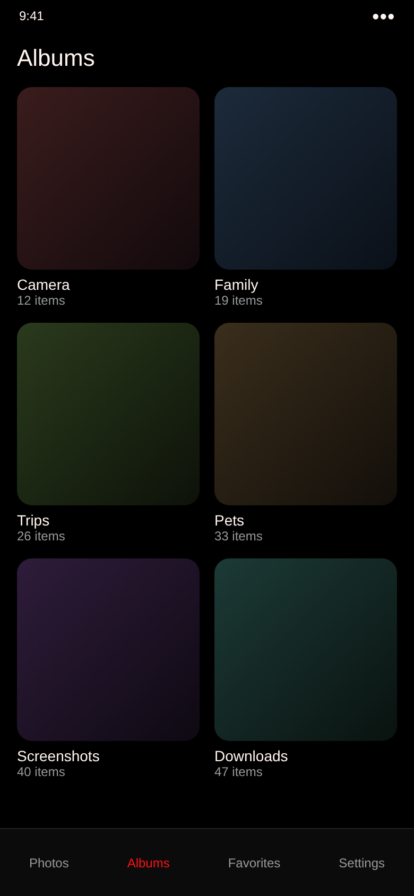
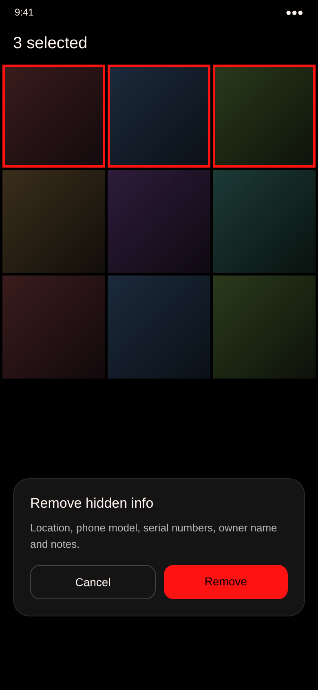
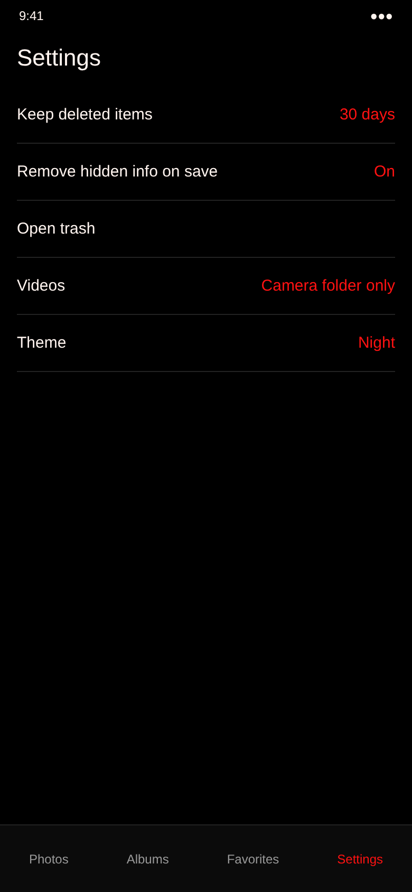

# Gallery

A private photo gallery for Android. Fully offline: no internet permission, nothing collected.

## Screens

These are design previews. The finished app follows this look.

<table>
  <tr>
    <td></td>
    <td></td>
    <td></td>
    <td></td>
  </tr>
</table>

## Features
- **Photos, Albums, Favorites, Settings** tabs
- Search and sort (newest, oldest, name, size)
- Videos from the **Camera** folder only
- **Remove hidden info**: location, phone model, serial numbers, owner name and notes. One photo, a selection, Select all or a whole album.
- **Sharing** always sends cleaned copies
- **Editor**: crop, rotate, light, color, filters. Saves a cleaned copy.
- **Trash** keeps deleted items 1–30 days (your pick)

## Download
1. Open **[Releases](../../releases/latest)**.
2. Download the newest `Gallery-build-N.apk`.
3. Open it on your phone and tap **Install**.

Requires Android 10 or newer. MIT license.
